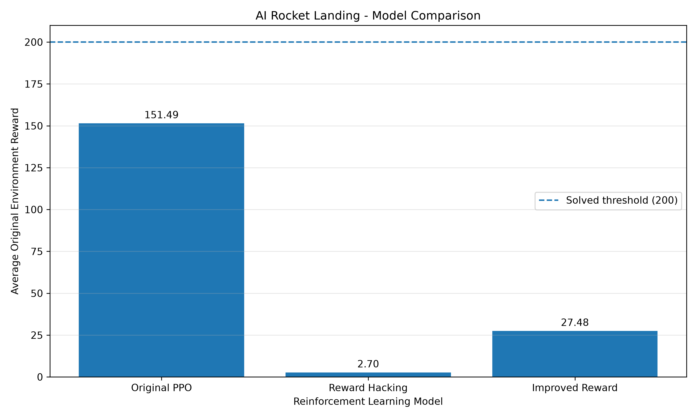

# 🚀 AI Rocket Landing using Reinforcement Learning

<h3 align="center">Training an Intelligent Agent to Land a Lunar Spacecraft using PPO and Reward Shaping</h3>

<p align="center">
  
  
  
  
  
</p>

---

## 🌌 Overview

Can an AI agent learn to land a spacecraft safely without being explicitly programmed with landing instructions?

This project explores that question using **Reinforcement Learning (RL)**. An intelligent agent is trained in the `LunarLander-v3` simulation environment using **Proximal Policy Optimization (PPO)**.

The project goes beyond basic model training by investigating how reward design influences agent behavior. Three experiments are conducted to understand baseline performance, reward hacking, and improved reward shaping.

The central objective is to explore how an agent learns through trial and error, and why designing the right reward function is essential for reliable AI systems.

## 🎯 Project Objectives

- Develop an autonomous lunar landing agent using PPO.
- Understand the interaction between an agent, environment, actions, and rewards.
- Establish a baseline using the original environment reward.
- Investigate unintended behavior through reward hacking.
- Implement an improved reward-shaping strategy.
- Evaluate and compare the performance of different reward functions.

## 🧠 Environment: LunarLander-v3

Built using [Gymnasium](https://gymnasium.farama.org/), the simulation provides an environment where the agent must control a lunar lander and attempt a safe landing.

| Component | Description |
|---|---|
| Environment | LunarLander-v3 |
| Observation Space | 8-dimensional state vector |
| Action Space | 4 discrete actions |
| Algorithm | Proximal Policy Optimization (PPO) |
| Policy | MLP Policy |
| Framework | Stable-Baselines3 |

**Available actions:**

| Action | Description |
|---|---|
| 0 | Do nothing |
| 1 | Fire left orientation engine |
| 2 | Fire main engine |
| 3 | Fire right orientation engine |

## ⚙️ Experiments

### Experiment 1 — Baseline PPO

The first agent was trained using the original LunarLander reward function.

- Algorithm: PPO
- Training timesteps: 1,000,000
- Policy: MlpPolicy
- Learning rate: 0.0003
- Gamma: 0.99

This experiment establishes the baseline performance for subsequent comparisons.

### Experiment 2 — Reward Hacking

A custom reward wrapper was introduced to investigate whether the agent could exploit a reward signal instead of prioritizing the intended landing objective.

The wrapper provides an additional reward when the lander maintains low angular and linear velocities:

```python
if abs(angle) < 0.1 and abs(x_velocity) < 0.1 and abs(y_velocity) < 0.1:
    reward += 1
```

The experiment produced behavior consistent with prolonged hovering or remaining within the rewarded stability conditions.

This demonstrates an important reinforcement learning challenge: **maximizing the designed reward does not always mean achieving the intended objective.**

### Experiment 3 — Improved Reward Shaping

An improved reward function was introduced to encourage progress toward a more stable state.

```python
stability = abs(angle) + abs(x_velocity) + abs(y_velocity)

improvement = previous_stability - stability

reward += 0.5 * improvement
reward -= 0.01
```

The reward is based on improvement in stability, with a small per-step penalty.

The objective was to encourage meaningful progress rather than simply rewarding the maintenance of a particular state.

## 📊 Experimental Results

All three trained models were evaluated on the original, unmodified LunarLander environment over 10 episodes.

| Model | Training Steps | Average Reward | Average Steps | Successful Episodes |
|---|---:|---:|---:|---:|
| Baseline PPO | 1M | **151.49** | 443.10 | 6/10 |
| Reward Hacking PPO | 500K | 2.70 | 980.50 | Not recorded |
| Improved Reward PPO | 500K | 27.48 | 396.10 | 2/10 |

*Success criterion: Episode reward ≥ 200.*

### 📈 Model Performance Comparison



### Key Observations

- **Baseline PPO:** Achieved the highest average reward and six successful episodes.
- **Reward Hacking PPO:** Achieved a low average reward and an average episode length close to the 1,000-step limit.
- **Improved Reward PPO:** Showed a different learning behavior but did not outperform the baseline in this evaluation.

These results highlight how reward design can significantly influence agent behavior and task performance.

## 🎥 Agent Demonstrations

Watch the trained agents in action through the recorded simulation episodes.

| Experiment | Video |
|---|---|
| Baseline PPO | [View Recording](videos/original_ppo/original_ppo-episode-0.mp4) |
| Reward Hacking PPO | [View Recording](videos/reward_hacking/reward_hacking-episode-0.mp4) |
| Improved Reward PPO | [View Recording](videos/improved_reward/improved_reward-episode-0.mp4) |

*Note: These are individual demonstration episodes. Their rewards are not the same as the 10-episode average evaluation results.*

## 🏗️ Project Architecture

```text
AI-Rocket-Landing-Reinforcement-Learning/
│
├── environment/
│   └── test_environment.py
│
├── src/
│   ├── random_agent.py
│   ├── train_ppo.py
│   ├── evaluate_agent.py
│   ├── reward_shaping.py
│   ├── train_reward_hacking.py
│   ├── evaluate_reward_hacking.py
│   ├── train_improved_reward.py
│   ├── evaluate_improved_reward.py
│   ├── plot_results.py
│   └── record_videos.py
│
├── models/
│   ├── ppo_baseline.zip
│   ├── ppo_lunar_lander.zip
│   ├── ppo_reward_hacking.zip
│   └── ppo_improved_reward.zip
│
├── results/
│   ├── experiment_summary.csv
│   └── model_comparison.png
│
├── videos/
│   ├── original_ppo/
│   ├── reward_hacking/
│   └── improved_reward/
│
├── requirements.txt
└── README.md
```

## 🛠️ Technology Stack

| Technology | Purpose |
|---|---|
| Python | Core programming language |
| Gymnasium | Reinforcement learning environment |
| Stable-Baselines3 | PPO implementation |
| PyTorch | Deep learning framework |
| NumPy | Numerical computations |
| Matplotlib | Performance visualization |
| Pandas | Experiment result analysis |
| MoviePy | Video processing |

## 🚀 Getting Started

### 1. Clone the repository

```bash
git clone https://github.com/vxhll/AI-Rocket-Landing-Reinforcement-Learning.git
```

```bash
cd AI-Rocket-Landing-Reinforcement-Learning
```

### 2. Create a virtual environment

```bash
python -m venv venv
```

### 3. Activate the environment

Windows:

```bash
venv\Scripts\activate
```

### 4. Install dependencies

```bash
pip install -r requirements.txt
```

### 5. Train the baseline agent

```bash
python src/train_ppo.py
```

### 6. Evaluate the trained agent

```bash
python src/evaluate_agent.py
```

Explore the other training and evaluation scripts in `src/` to reproduce the reward-hacking and improved-reward experiments.

## 💡 Key Learning Outcomes

Through this project, I explored:

- Reinforcement Learning fundamentals.
- Policy optimization using PPO.
- Continuous learning through trial and error in a discrete-action environment.
- Custom reward function implementation.
- Reward hacking and unintended agent behavior.
- Model evaluation and experimental comparison.
- Visualization and video recording of trained agents.

## 🔭 Future Improvements

- Increase training timesteps and evaluation episodes.
- Experiment with alternative reward functions.
- Improve landing consistency and success rate.
- Compare PPO with other reinforcement learning algorithms.
- Introduce more comprehensive statistical evaluation.
- Explore curriculum learning and environment variations.

## 👨‍💻 Author

**Vishal J**

AI/ML Engineer | Reinforcement Learning | Computer Vision | NLP

<p>
  <a href="https://github.com/vxhll">
    
  </a>
  
  <a href="https://www.linkedin.com/in/vishal-j-btech">
    
  </a>
</p>

---

<p align="center">
  <b>Built with curiosity, experimentation, and Reinforcement Learning.</b>
  <br>
  ⭐ If you find this project interesting, consider starring the repository!
</p>
